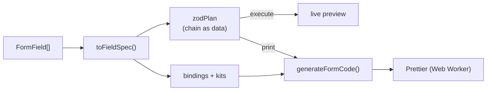

# Formia

**A visual form builder that exports real code, not a runtime you have to keep.**

Drag fields onto a canvas, set validation rules, test the live form, then export a portable **JSON schema** or a ready-to-paste **React component** for **React Hook Form**, **Formik** or **TanStack Form**, styled with **Tailwind** or **Material UI**.


## Why

Most form builders make you ship their renderer. Formia's output is **one `.tsx` file you own**: a Zod (or Yup) schema, typed input and output, accessible markup and the form library you already use. Nothing from Formia is imported at runtime.

- **What you test is what you ship.** The preview and the generated code are driven by the same validation description, so they cannot drift apart.
- **Generated code reads like hand-written code.** It is Prettier-formatted, uses each library's idiomatic API, and wires `aria-invalid`, `aria-describedby` and `role="alert"`.

## Features

- **30 element types** (21 inputs, 9 layout/content) from a searchable palette, via drag and drop (pointer and keyboard) or click.
- **Tabs and sections** as areas on the canvas: drop fields inside a box to group them, or leave them outside. Tabbed forms get Next/Previous with per-tab validation and editable button text.
- **Right-to-left forms** (Persian, Arabic, Hebrew): one toggle flips the preview and the generated code. The UI ships with the Vazirmatn font for Persian text.
- Two fields per row; headings, dividers, alerts and areas take a full row. Buttons fill their row, and a submit button beside another element gets twice its width.
- Per-field editor: label, name, default, options, custom placeholder (date and time fields), and validation with custom messages.
- **Undo/redo** (100 steps), debounced **autosave** (also saved when the page is hidden or closed), 11 built-in **templates** (2 are multi-step or sectioned), each in English or Persian, plus your own, validated JSON **import/export**.
- **Live preview** with real validation, desktop/mobile widths and a simulated submit.
- **Six code outputs**: React Hook Form + Zod, Formik + Yup, TanStack Form + Zod, each in Tailwind or MUI, with install commands for npm, pnpm, yarn and bun. Tabs, sections and direction are generated too.
- **Installable and offline** (PWA): works with no network after the first visit, and asks before updating.
- **Keyboard first**: a shortcuts guide on `?`, skip links, and an actions menu that collapses on small screens.

## Quick start

Requires Node 20.19+ or 22.12+.

```bash
git clone https://github.com/AriaNaderidev/dynamic-form-generator.git
cd dynamic-form-generator/form-generator
npm install
npm run dev            # http://localhost:5173
```

| Script | Purpose |
|---|---|
| `npm run build` | `tsc -b && vite build` |
| `npm run preview` | Serve the production build. Use this, not `dev`, to measure performance or try the PWA (the service worker only exists in a build). |
| `npm run lint` / `npx tsc -b` | ESLint 9 / type-check only |

## Usage

1. Start from a template or drag fields in; click a card's pencil to edit it.
2. Check the **Preview** tab; open **Schema** or **Code** to export.
3. In **Code**, pick a library and UI kit, run the install command, and copy or download the file:

```tsx
<ContactForm onSubmit={async (values) => { await saveToApi(values); }} />
```

Real output for the built-in Contact template (React Hook Form + Zod), trimmed:

```tsx
export const contactFormSchema = z.object({
  email: z.string().min(1, "This field is required").pipe(z.email("Enter a valid email address")),
  message: z.string().min(1, "This field is required").min(10, "Minimum 10 characters"),
});
export type ContactFormInput = z.input<typeof contactFormSchema>;
export type ContactFormOutput = z.output<typeof contactFormSchema>;

const { register, handleSubmit, formState: { errors, isSubmitting } } =
  useForm<ContactFormInput, unknown, ContactFormOutput>({
    resolver: zodResolver(contactFormSchema), defaultValues, mode: "onTouched",
  });
```

### Tabs, sections and direction

- **Tab** and **Section** are palette items that create an empty area. Drop fields between its header and footer to put them inside; a field below the footer is outside. Deleting an area keeps its fields. A tab sits at the top level; a section sits at the top level or inside a tab.
- On a tabbed form, every tab after the first has a back link at the top and a full-width Next at the bottom. **Next** checks the tab first, and a failed submit jumps to the first tab with an error. Set the button text on the Tab's editor.
- The **LTR / RTL** toggle is in the canvas header. It is saved with the form and exported in the JSON.
- Each template card has an EN / فا toggle; the Persian version applies right-to-left on use.

### Install and offline

Build and serve (`npm run build && npm run preview`), open the app once, then install it from the browser (or "Add to Home Screen" on iOS). After the first visit everything, including the Schema and Code tabs, works offline. A new version shows a "Refresh" prompt; it never reloads on its own, and the form is restored from autosave.

### Shortcuts

Press `?` for the full guide. Common ones: `Ctrl/⌘+Z` undo, `Ctrl/⌘+Shift+Z` redo, `/` search the field list, `Alt+1…4` jump between panels, `A` then `I` / `E` / `T` / `C` import, export, save a template or clear, and `Alt+↑/↓` move a row from the canvas. Shortcuts without a modifier are ignored while you type. Everything is stored locally in `localStorage` (`form-builder:*` keys); nothing leaves the browser.

## JSON schema

```json
{ "version": 1, "direction": "rtl", "fields": [
  { "id": "b1…", "type": "tab", "label": "General" },
  { "id": "aacf75f4-…", "type": "text", "name": "firstName", "label": "First name",
    "validation": { "required": true }, "rowId": "aacf75f4-…" },
  { "id": "e1…", "type": "end", "name": "end" } ] }
```

`id` is a UUID used by the canvas; **`name` is the submitted data key and the generated code key** (it must match `^[A-Za-z_$][\w$-]*$`). Fields sharing a `rowId` render side by side. `direction` is left out for left-to-right. A `tab` or `section` owns everything up to its matching `end`, so order alone says what is inside (forms saved before areas existed still open: a marker then runs to the next one). Import validates `version`, `id`, `name` and `type` and keeps unknown keys, so files survive a round trip. Rules: required, min/max length, pattern, min/max number, earliest/latest date or time (with a `today` token), and file size and types.

## Architecture



```
src/features/
  form-schema/   Types, catalog, FieldSpec, Zod plan, tab/section layout, templates: the single source of truth
  form-builder/  Canvas, palette, field editor, undo/autosave, dnd, shortcuts
  form-renderer/ Live form rendered from specs (tabs, sections, direction)
  preview/       Preview, Schema and Code tabs
  codegen/       Bindings (RHF/Formik/TanStack), kits (Tailwind/MUI), printers, formatter
  pwa/           Service worker registration, install prompt, update and online status
```

- **Validation is defined once.** `toFieldSpec` describes a field; `zodPlan` expresses it as a chain of calls as *data*. The preview executes the plan; the generator prints it. The Yup printer reads the same specs.
- **Codegen is composed, not templated.** A `Binding` per library (how a control connects to state) and a kit per UI library (markup) give 6 outputs from 3 + 2 pieces.
- **All writes go through one `setFields`**, which normalises areas and rows and records history, so every mutation is undoable and canonical.
- **Layout is read once.** `buildLayout` turns the flat list into tabs, sections and rows; the preview and the generator both walk that result.

## Engineering notes

- Split context (data vs stable actions), memoised cards and `useDeferredValue` on the preview keep editing and dragging responsive.
- A custom dnd-kit collision strategy ignores the canvas droppable during reorders, which otherwise "wins" over neighbouring cards and makes items snap back.
- Rows do not slide aside while dragging: areas cannot resize mid-drag, so a line marks the drop spot instead, and a drop moves a row (or a whole area) to just above or below the hovered row.
- Offline: the service worker precaches the whole build, including lazy chunks, and the Schema and Code tabs are prefetched when the app is idle. It uses a prompt-based update, never a silent reload.
- Vazirmatn loads only when Persian or Arabic text appears (`unicode-range`). RTL Material UI forms use `stylis-plugin-rtl`, because MUI styles use physical left/right.
- Stored and imported data (autosave, templates, files) is re-validated on read; storage access is wrapped in try/catch.
- Motion is CSS tokens with one global `prefers-reduced-motion` rule; scrollbars are styled by one global rule.

## Performance

Measured on the production build (Lighthouse mobile, simulated slow 4G, 4x CPU):

| | Before | After |
|---|---:|---:|
| Score | 25 | **86** |
| FCP / LCP | 7.5 s / 15.4 s | 2.7 s / 3.6 s |
| Total Blocking Time | 2,670 ms | 40 ms |

Key techniques: per-icon imports (12,888 to 1,978 dev modules), vendor chunking plus lazy Schema/Code tabs and field editor, a 62 KB WebP in place of a 1.37 MB PNG, a Latin-subset font, highlighting via `refractor` and CSS classes instead of per-token React elements, and Prettier in a Web Worker with a result cache (switching library or UI kit: about 3.9 s to 0.3 s on a 10-field form at 4x CPU).

## Extending

- **New field type:** `types.ts`, `catalog.ts`, `palette_config.ts`, a `fieldSpec` kind, a case in `FieldControl.tsx`, and cases in both kits and the binding.
- **New template:** add the English one to `templates.ts` and its Persian twin (same id plus `-fa`, `direction: "rtl"`) to `templatesBasicFa.ts`. Tabs and sections go in `templatesStructured.ts` as a family with both versions, closing each area with `{ type: "end" }`.
- **New form library:** implement `Binding`, add its dependencies and schema printer in `generate.ts`.
- **New UI kit:** add renderers in `codegen/kits/`.
- **Validation changes** go in `fieldSpec.ts` / `zodPlan.ts` only, then re-check the generated output.

## Tooling and conventions

TypeScript strict, ESLint 9, Prettier (Tailwind plugin), Husky (`pre-commit` runs lint-staged, `pre-push` runs the build). Conventional commits with a scope, one feature per commit. See [`CLAUDE.md`](./CLAUDE.md) for repository conventions.

## Limitations

- **No automated tests yet.** Good first additions: snapshot and type-check tests over `generateFormCode` for all six combinations, and unit tests for `rows_helper` and `toFieldSpec`.
- Two fields per row by design; the preview's submit is simulated; file fields generate validation but not upload handling.
- The generated Tailwind and MUI code assumes those libraries are already set up in your project. An RTL Material UI form also needs `@emotion/cache` and `stylis-plugin-rtl` (listed in its install command).
- A date or time field's custom placeholder shows in the preview only: generated code uses native date inputs (Tailwind) or MUI X pickers, which do not take custom text.
- No cross-field rules yet (for example "passwords match"), and no national-ID style checksum validators.
- The service worker is part of the production build only; `npm run dev` has no offline support.
- No license file yet.
